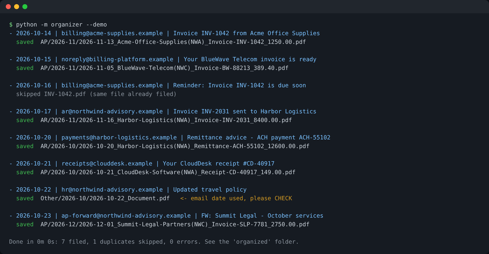
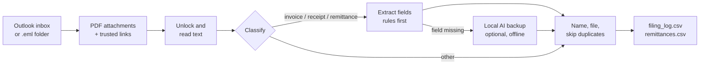

# Finance Email Organizer

**Stop downloading, renaming and filing invoices by hand.** This Python tool reads a finance inbox, finds invoices, ACH remittance advices and receipts, and files each PDF with a standard name and folder. It also writes a log that is ready for Excel or Power BI.



> This is a cleaned, generic version of a tool I run in production for a financial services group, where it saves the finance team about **5 hours per week**. All companies, people and numbers in this repository are fictional.

## The problem

Accounts payable and receivable teams get dozens of PDFs by email every week: vendor invoices, payment reminders, receipts from SaaS tools and remittance advices from customers who paid by ACH. Someone has to open each one, find the vendor, amount and due date, rename the file and save it in the right folder. It is slow, easy to get wrong, and duplicates pile up.

## What it does

| Step | Detail |
| --- | --- |
| 1. Read the inbox | Microsoft 365 / Outlook through Microsoft Graph, **read-only** (`Mail.Read`). Junk email is never read. |
| 2. Collect PDFs | Attachments, plus "View invoice" links from **trusted domains only**. |
| 3. Unlock | Password-protected PDFs are opened with known passwords and saved as an unlocked copy. |
| 4. Classify | Invoice, remittance advice, receipt or other document. |
| 5. Extract | Counterparty, group entity, document number, amount and due or payment date. |
| 6. File | `AP` or `AR` folder by month, with one naming standard. |
| 7. Skip duplicates | Same file (SHA-256) or same document number is filed only once, across runs. |
| 8. Log | `filing_log.csv` for every document and `remittances.csv` for cash application. |

**Example result**

```
organized/
├── AP/2026-11/2026-11-13_Acme-Office-Supplies(NWA)_Invoice-INV-1042_1250.00.pdf
├── AP/2026-11/2026-11-05_BlueWave-Telecom(NWC)_Invoice-BW-88213_389.40.pdf
├── AR/2026-10/2026-10-20_Harbor-Logistics(NWA)_Remittance-ACH-55102_12600.00.pdf
├── AR/2026-11/2026-11-16_Harbor-Logistics(NWA)_Invoice-INV-2031_8400.00.pdf
├── filing_log.csv
└── remittances.csv      <- which invoices each customer payment covers
```

File name pattern: `due-date_counterparty(entity)_type-number_amount.pdf`. The entity code shows which company of the group the document belongs to, which matters for groups with several legal entities.

## How it works



- **Rules first, AI second.** Extraction is deterministic (regular expressions), so results are predictable and auditable. Only when a field is missing, an optional local model ([Ollama](https://ollama.com)) fills the gap, and the file name gets an `_AI` mark so a person can review it.
- **Privacy by design.** The AI runs on your own machine: no document is sent to a cloud service.
- **When unsure, it says so.** If no date is found in the document, the email date is used and the run prints `please CHECK`.

## Quick start (2 minutes, no login needed)

Requires Python 3.10 or newer.

```bash
git clone https://github.com/FabioFerreiraFSF/finance-email-organizer.git
cd finance-email-organizer
python -m venv .venv
.venv\Scripts\activate          # Windows  (macOS/Linux: source .venv/bin/activate)
pip install -r requirements.txt
python -m organizer --demo
```

The demo processes the fake inbox in `samples/inbox/` (8 emails) and creates the `organized/` folder.

## Use it with your Outlook mailbox

1. Ask your IT team for an Entra ID (Azure) app registration with the delegated permission `Mail.Read` and "Allow public client flows" turned on.
2. Copy `.env.example` to `.env` and fill in `GRAPH_CLIENT_ID` and `GRAPH_TENANT_ID`.
3. Copy `config.example.json` to `config.json` and add your companies, tax IDs and known vendors.
4. Run it:

```bash
python -m organizer --outlook                                  # newest 50 emails
python -m organizer --outlook --since 2026-10-01 --until 2026-10-31
```

The first run shows a short code to type at microsoft.com/devicelogin. After that, the login renews by itself.

## Configuration

| File | What goes in it | In Git? |
| --- | --- | --- |
| `config.json` | Group entities and tax IDs, own email domains, vendor name aliases, trusted link domains | No |
| `.env` | Microsoft Graph IDs, PDF passwords, AI and OCR settings | No |
| `config.example.json`, `.env.example` | Fictional examples to copy from | Yes |

## Security

- Read-only mailbox access (`Mail.Read`), least privilege.
- Links are followed only over HTTPS and only when the **host name** is on the allowlist. A lookalike such as `https://evil.example/?x=vendor.com` is rejected.
- Downloads must really be PDFs (checked by their first bytes).
- Secrets, tokens, real documents and outputs are excluded by `.gitignore`.

## Tests

```bash
pytest
```

The suite covers classification, field extraction, date formats, the link allowlist and a full end-to-end run on the sample inbox, including a second run that must not duplicate anything.

## Project structure

```
organizer/
├── __main__.py     command line and run summary
├── auth.py         Microsoft Graph login (device code + token cache)
├── mailbox.py      Outlook reader and .eml folder reader
├── links.py        safe download of linked PDFs
├── pdf_reader.py   unlock, text extraction, OCR fallback, classification
├── extract.py      counterparty, entity, number, amount, date, AP/AR
├── ai_fallback.py  optional local AI backup
├── filer.py        naming, folders, duplicate index
└── config.py       settings from config.json and .env
scripts/make_samples.py   builds the fake sample inbox
tests/                    unit and end-to-end tests
```

## Possible extensions

- Push the extracted data straight into QuickBooks, Xero or NetSuite as draft bills.
- Match remittance advices to open invoices automatically and flag short payments.
- Browser automation (Playwright) for vendor portals that only show the invoice after a login. The production version includes handlers like this; they are client-specific and not published here.

## About

Built by **Fabio Ferreira**, Financial Controller with 14+ years in controllership and FP&A. I build finance automations with Python, Power BI and Excel for small and mid-size companies.

## License

MIT. See [LICENSE](LICENSE).
